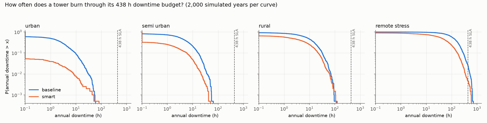
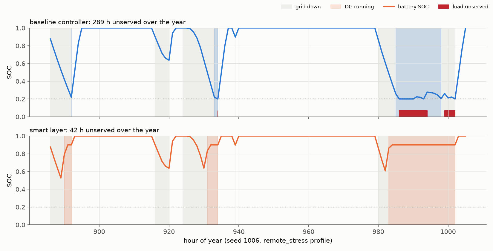

# Tower power continuity: proof of concept

**Goal:** keep `P(annual downtime > 438 h) <= epsilon` for each tower, without replacing the existing power controller.
**Approach:** simulate the *energy reserve* of one tower hour by hour for thousands of random years, then test controller changes on those same years.

All parameters are illustrative placeholders, not fitted to real fleet data. Absolute numbers will change when you calibrate; the structure and the relative findings are the useful part.

## 1. Model (one DC bus, 1-hour steps)

```
 solar ─┐
 grid ──┼─ rectifier ─┬─ load (radio + transport + cooling)
 DG ────┘             └─ battery  (buffer only; recharged by the same rectifier)
```

- **Downtime** happens only when the battery hits its low-voltage floor while no AC source (grid or DG) is up. Switching is never the failure.
- **Coupling:** the rectifier carries load *and* battery charging (limited by rectifier size and charge C-rate). Grid and DG recharge the same battery.
- **No double counting:** `solar + AC input = load served + curtailed solar + losses + change in battery energy`, checked every hour. Worst residual over all runs was about 4e-15 kWh.
- **Usable battery energy:** `C_nominal x SOH x (SOC - SOC_min)`, with SOH drawn per site-year from 0.70 to 1.00.
- **Load:** base radio plus traffic term (evening peak) plus cooling that rises with temperature above 18 C. Raise `traffic_kw` / `base_kw` for 5G or more users.
- **Grid:** Poisson outages with heavy-tailed lognormal durations, follow-up outages (flapping, so the battery may still be half-drained), and storms, a share of which are forecast 24 h ahead.
- **Diesel generator:** start-up delay (battery covers it), latent faults that block starting (minor ones fixed in hours, major ones in days), fuel burn from a standard genset curve.
- **Fuel logistics:** tank size, lognormal delivery lead time, occasional badly delayed orders, theft.

Four site profiles: `urban` (grid ~99%), `semi_urban` (~92%), `rural` (~77%), and `remote_stress` (~55%, slow and unreliable fuel, slow DG repair; deliberately harsh).

## 2. Controller: baseline vs smart layer

The smart layer changes setpoints and schedules on the *existing* controller. It has four independent levers:

| Lever | Baseline | Smart |
|---|---|---|
| DG start rule | start at fixed SOC 40% | start when **hours of battery left** drop below 3 h (first start, leaves time to fix a failed start) or 1.5 h (once the DG has proven healthy this outage) |
| Storm readiness | none | storm alert: test the DG, top the tank up, call the DG at outage start |
| DG self-test | faults found only when a start fails during an outage | weekly 15-minute test finds latent faults early |
| Fuel ordering | reorder at 25% tank | reorder from burn rate x delivery lead time; place a backup order if the first is late |

The autonomy rule can be written back to the site controller as a dynamic SOC start setpoint: `SOC_start = SOC_min + A_req x P_plan / (eta_d x C_nom x SOH)`.

## 3. Results (2,000 simulated years per profile, same random years for each policy)

| Profile | Policy | P(>438 h) | 95% upper bound | P(>100 h) | Mean downtime (h) | P99 (h) | Diesel (L/yr) |
|---|---|---|---|---|---|---|---|
| urban | baseline | 0.00% | 0.19% | 0.0% | 3.2 | 30 | 19 |
| urban | smart | 0.00% | 0.19% | 0.0% | 0.3 | 8 | 32 |
| semi-urban | baseline | 0.00% | 0.19% | 0.0% | 6.2 | 36 | 169 |
| semi-urban | smart | 0.00% | 0.19% | 0.0% | 1.7 | 21 | 236 |
| rural | baseline | 0.00% | 0.19% | 0.1% | 13.2 | 70 | 673 |
| rural | smart | 0.00% | 0.19% | 0.1% | 7.4 | 61 | 824 |
| remote stress | baseline | 2.50% | 3.28% | 58.0% | 142.6 | 517 | 1,646 |
| remote stress | smart | 0.45% | 0.85% | 22.9% | 65.9 | 343 | 1,935 |

Lever ablation on `remote_stress` (each lever alone, same years):

| Policy | P(>438 h) | Mean downtime (h) | Diesel (L/yr) |
|---|---|---|---|
| baseline | 2.50% | 142.6 | 1,646 |
| + autonomy start only | 1.80% | 153.4 | 1,818 |
| + storm readiness only | 1.90% | 137.4 | 1,655 |
| + DG self-test only | 2.20% | 143.0 | 1,645 |
| + fuel logic only | 0.60% | 68.5 | 1,731 |
| all four (smart) | 0.45% | 65.9 | 1,935 |




The event trace picks the seed (out of 200) where the smart layer helps most, so it illustrates a mechanism; it is not typical. In that year the baseline lost 104 h to an empty tank and 178 h to DG faults; the smart layer lost no hours to fuel.

## 4. What this says

1. **At this level of 95%, the annual budget is loose for most sites.** Under the three realistic profiles no simulated year exceeded 438 h. The 95% upper bound of about 0.19% reflects only 2,000 years, so the true probability is not proven zero. Meaningful risk shows up only in the harsh profile.
2. **The real gains show up well below the SLA line.** In every profile the smart layer cuts mean downtime and the chance of passing 24 h (for example rural: 16.9% to 8.7%). The chance of passing 100 h drops on the stress site (58% to 23%) and is about 0.1% in rural for both policies. Those are the early-warning indicators to track.
3. **Fuel logistics is the biggest lever on the harsh site**, which is why the fuel-logic row is nearly as good as the full package. Autonomy-based start, storm readiness and self-testing each help little on their own here, and the autonomy rule alone raises mean downtime slightly (153 vs 143 h) while burning more diesel.
4. **What remains is mostly DG faults** (96% of residual downtime on the stress site with the smart layer). No setpoint fixes a generator that needs a multi-day repair. That needs hardware or process changes: faster repair response, a mobile or second generator, more battery or solar.
5. **There is a green-energy cost.** The smart layer burns about 18% more diesel on the stress site (1,935 vs 1,646 L/yr, about 0.8 t CO2) and places far more fuel orders (about 57 vs 10 per year). Reliability is bought partly with diesel and deliveries. Tune the reorder trigger and the 3 h / 1.5 h autonomy thresholds against that cost, and treat larger battery or solar as the greener alternative to test next.

## 5. Limitations

- Parameters are invented; calibrate from your fleet's outage logs, DG fault and repair records, fuel delivery history, and measured load.
- Hourly time step. Sub-hour grid blips are rounded to a whole hour.
- No temperature effect on battery capacity, no battery cycle ageing, no solar forecast error (a 15% safety factor stands in for it), and the 4-hour planning load uses the true future load.
- Fuel theft and vendor failure are simple random events. Fuel and delivery cost are not modelled.
- Plain Monte Carlo cannot resolve very small probabilities. To certify an epsilon of 0.1% or less, add importance sampling or fit an extreme-value tail to the annual downtime distribution.
- Policy comparison uses the same random years, which reduces noise, but all results inherit the model's assumptions.

## 6. Next steps toward production

1. Fit grid, DG and fuel parameters per cluster of sites.
2. Replace the planning-load rule and storm flag with real forecasts, validated against held-out outage history.
3. Search for the cheapest combination of battery size, solar size, tank size and policy thresholds that meets epsilon.
4. Shadow-mode pilot: the smart layer recommends setpoints, engineers compare against what the controller did, and only then write them back.

## 7. Run it

```
pip install numpy matplotlib
python tower_power_poc.py --years 2000 --out out     # about 4 minutes on 2 cores
python make_figures.py
```

Files: `tower_power_poc.py` (model and policies), `make_figures.py`, `out/results.csv` (all metrics, including cause shares and CO2).
